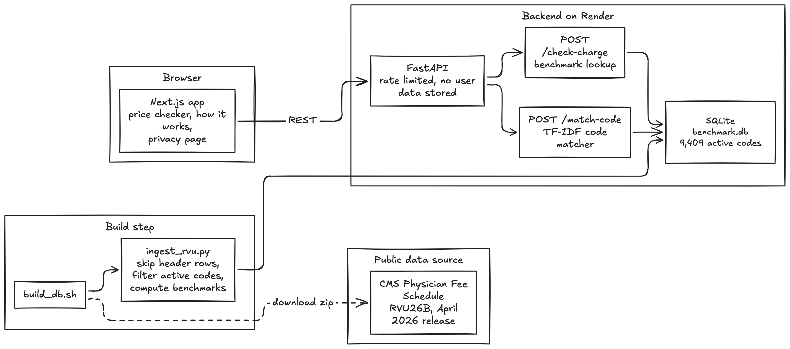
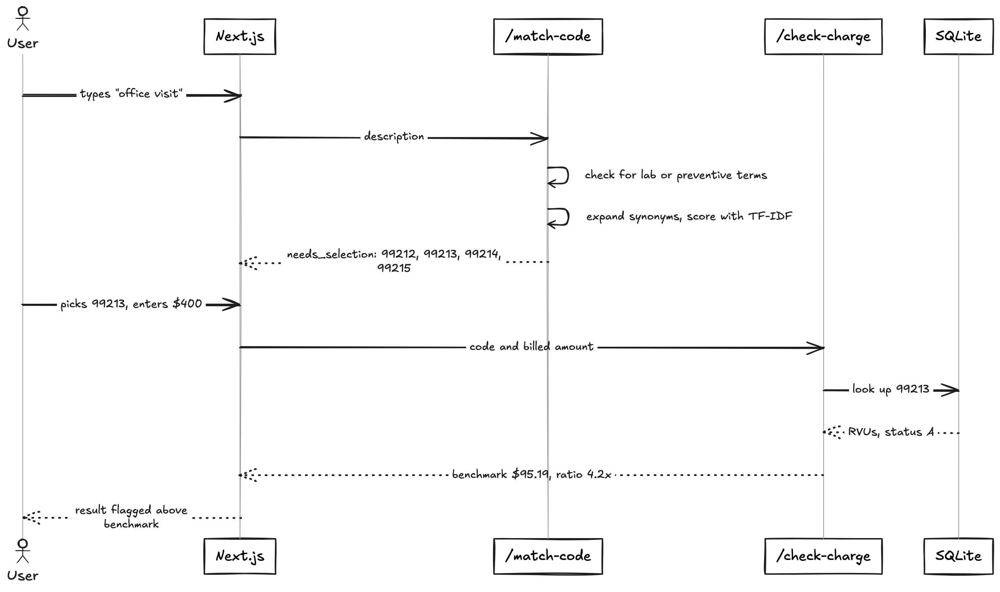

# MedLedger

Ever gotten a medical bill and had no idea whether the price was normal? MedLedger compares a charge against the real Medicare benchmark for that procedure, computed from the government's own pricing data. No upload, no account, no AI reading your bill. Just public data and math you can check yourself.

**Live app:** [medvoiceapp.vercel.app](https://medvoiceapp.vercel.app)

---

## Why this exists (and why it's not what it used to be)

This project started as an AI bill reader. You uploaded a photo of your bill, Claude explained the charges and wrote an appeal letter. It worked, but one question kept bothering me: if someone can paste their bill into Claude and get the same answer, what is this tool actually adding?

The honest answer was not much. So I rebuilt it around something a chatbot can't do on its own: comparing a real charge against a real, cited government benchmark, computed by code instead of guessed by a model.

The rebuild also removed every reason to handle personal data. No upload means no health information ever reaches the server. No accounts means nothing to secure or leak.

---

## What it does

You enter a CPT code and the amount you were billed. MedLedger looks it up in Medicare's Physician Fee Schedule, computes the national benchmark, and shows the dollar difference and the ratio.

If you don't know your code, describe the visit in plain words ("office visit", "chest xray", "flu shot"). A text matcher maps it to a curated set of common outpatient codes. When the description can't settle the exact code, like an office visit whose billing level only your doctor's coding decision would show, it gives you the real options and lets you pick instead of guessing. When you describe something this tool doesn't price yet, like a lab test, it says exactly why.

---

## Architecture



The database is never committed to git. Every deploy downloads the official CMS release and rebuilds it from scratch, so the data always traces back to a public, versioned government file, and the ingestion script, not a binary file, is the source of truth. Because the rebuild happens at build time rather than startup, a cold start on Render's free tier just boots the server instead of reprocessing the data.

---

## How a benchmark is calculated

Every payable code carries three relative value units (RVUs). The benchmark is:

```
(Work RVU + Practice Expense RVU + Malpractice RVU) x Conversion Factor
```

The conversion factor is read from each row of the CMS file (33.4009 for this release), not hardcoded. For CPT 99213, an established patient office visit:

```
(1.30 + 1.46 + 0.09) x 33.4009 = $95.19
```

Codes CMS marks as anything other than active (status `A`) return "no benchmark available" instead of a misleading $0.00. Routine blood draws, for example, are priced under a separate lab schedule.

---

## Matching a description to a code



The matcher returns one of four outcomes:

| Status | When | What the user sees |
|---|---|---|
| `confident` | One clear winner ("flu shot") | A single code to confirm |
| `needs_selection` | Top scores within 0.08 of each other | A shortlist to pick from |
| `unsupported` | Lab or preventive visit terms | An explanation of why it isn't priced |
| `low_confidence` | Best score under 0.30 | A prompt to rephrase or enter the code |

**Why it's scoped to 37 codes instead of all 7,648 active ones.** Most of the fee schedule is specialist procedures like implantable sensor removal, which no patient would describe in matching words. Scoping to common outpatient codes (office visits, imaging, EKGs, vaccines, minor procedures) keeps the matcher accurate for what people actually see on a bill, and makes an honest test set possible.

**Why a shortlist instead of a best guess.** Testing showed that for ambiguous families, the correct code consistently ranked in the top few, just not always first, because the deciding detail (a visit's complexity level, a splint's type) isn't in the patient's description at all. Forcing one answer would mean guessing information that doesn't exist in the input. The shortlist keeps a person in the loop before a code becomes a price.

---

## Testing

`pricing/eval_matcher.py` runs the matcher against 18 labeled queries covering confident matches, shortlists, unsupported categories, and an unrelated query that should be rejected.

**Current result: 17/18 (94%), with zero confidently wrong answers.** The one miss ("stitches") returns low confidence rather than a wrong code, because the real CMS description is mostly location and size shorthand that shares little text with the query.

GitHub Actions runs on every push: the backend job confirms the API imports cleanly, and the frontend job runs a full production build.

---

## Known limitations

* Benchmarks are national rates. Regional (GPCI) adjustment isn't applied yet.
* Lab tests and preventive visits aren't priced. They live under CMS schedules this tool doesn't ingest yet.
* Spelled out view counts ("two views") narrow chest x-ray results to a shortlist of two instead of resolving to one code. Typing the digit ("2 views") resolves correctly.
* Medicare rates are a reference point, not a legal maximum. Private insurance and cash prices often run higher, and that alone doesn't mean a charge is wrong.

---

## Tech Stack

**Frontend:** Next.js, CSS Modules, Motion, react-hot-toast

**Backend:** FastAPI, scikit-learn (TF-IDF), pandas, slowapi

**Data:** SQLite, rebuilt at deploy time from the CMS Physician Fee Schedule

**Deployment and CI:** Vercel (frontend), Render (backend), GitHub Actions

---

## Running it locally

### Backend

```bash
git clone https://github.com/ryanluongLL/MedVoice.git
cd MedVoice
python3 -m venv venv
source venv/bin/activate          # venv\Scripts\activate on Windows
pip install -r requirements.txt
bash build_db.sh                  # downloads CMS data, builds pricing/benchmark.db
uvicorn main:app --reload
```

No `.env` file is needed. Nothing in the backend requires a secret or a database connection string.

### Frontend

```bash
cd frontend
npm install
echo "NEXT_PUBLIC_API_URL=http://localhost:8000" > .env.local
npm run dev
```

### Run the matcher evaluation

```bash
cd pricing
python eval_matcher.py
```

---

## Project structure

```
MedVoice/
├── main.py                  # FastAPI app, CORS, rate limiting
├── build_db.sh              # downloads CMS data, builds benchmark.db
├── requirements.txt
├── pricing/
│   ├── ingest_rvu.py        # parses the raw CMS file into SQLite
│   ├── lookup.py            # command line benchmark lookup
│   ├── matcher.py           # description to CPT code matching
│   └── eval_matcher.py      # labeled test set for the matcher
├── routers/
│   ├── pricing.py           # POST /check-charge
│   └── match.py             # POST /match-code
└── frontend/
    └── app/
        ├── page.js          # the price checker
        ├── how-it-works/    # the formula with a worked example
        └── privacy/         # what's collected (nothing)
```

---

## About

Built by **Luan Luong**, CS student at Cal State Fullerton.

* GitHub: [@ryanluongLL](https://github.com/ryanluongLL)
* Email: luanluongforwork@gmail.com